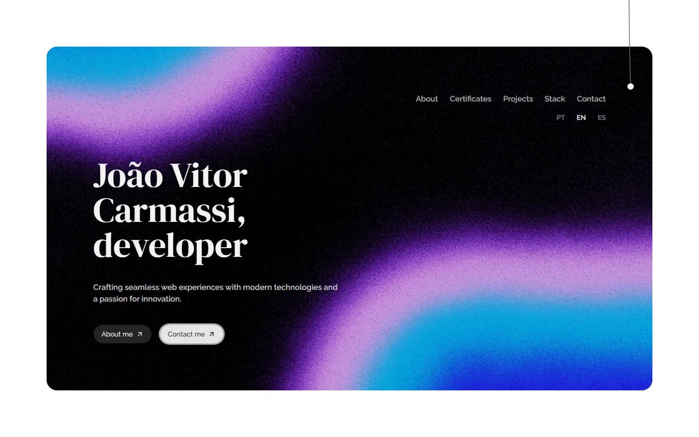

# Portfolio

Multilingual developer portfolio of João Vitor Carmassi, built with Astro, React and Tailwind.



**Live:** <https://joaocarmassi.com>

## Features

- Presents about, certificates, projects, tech stack and contact sections
- Available in Portuguese, English and Spanish with a language switcher
- Animated hero, custom cursor, smooth scrolling and a draggable theme cord
- Contact form with validation
- SEO-ready: canonical and hreflang tags, sitemap, robots.txt and `llms.txt`
- Includes a Starlight-based documentation section for the Prisma UI component library

## Tech stack

- Astro 7 with React 19 islands and TypeScript
- Tailwind CSS 4, shadcn/ui, Radix UI and Base UI components
- GSAP, Motion and Lenis for animation and scrolling
- React Hook Form and Zod for forms, TanStack Query for requests
- GitHub Pages, deployed through a GitHub Actions workflow

## Getting started

### Prerequisites

- Node.js 22.12 or newer

### Install

```sh
git clone https://github.com/joao-carmassi/portifolio.git
cd portifolio
npm install
npm run dev
```

Open the local URL printed by Astro (default <http://localhost:4321>).

## Configuration

`.env` is committed on purpose, because GitHub Pages builds from the repo. It holds public values only:

- `PUBLIC_SITE_URL`: deployed origin without trailing slash, used for canonical URLs, hreflang, sitemap, robots.txt and the og:image URL.

Secrets belong in `.env.local` (ignored) or in GitHub Actions secrets.

## Deployment

`npm run build` writes the static site to `dist/`. `npm run preview` serves the build locally.

## License

No license specified.

---
Made by [João Carmassi](https://github.com/joao-carmassi)
